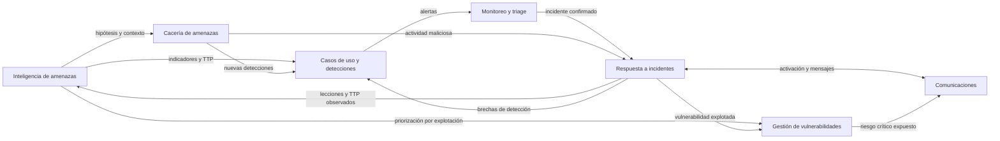

# Procedimientos operativos estándar (SOP)

Plantillas de **procedimientos operativos estándar** para los procesos principales de ciberseguridad. Cada SOP describe **quién hace qué, cuándo, con qué entradas, qué produce y cómo se mide**, para que el trabajo no dependa de personas concretas.

| Código | Procedimiento | Madurez relacionada | Buenas prácticas |
|---|---|---|---|
| [SOP-SOC-01](SOP-SOC-01-monitoreo-y-triage.md) | Monitoreo, triage y escalamiento de alertas | [SOC](../maturity-assessment/soc/) | [NIST/CISA SOC](../best-practices/nist-cisa/soc.md) |
| [SOP-SOC-02](SOP-SOC-02-gestion-de-casos-de-uso.md) | Gestión de casos de uso y detecciones | [SOC](../maturity-assessment/soc/) | [Detection as Code](../detection-as-code/) |
| [SOP-CTI-01](SOP-CTI-01-ciclo-de-inteligencia.md) | Ciclo de inteligencia de amenazas | [CTI](../maturity-assessment/cti/) | [NIST/CISA CTI](../best-practices/nist-cisa/cti.md) |
| [SOP-VUL-01](SOP-VUL-01-gestion-de-vulnerabilidades.md) | Gestión de vulnerabilidades | [Vulnerabilidades](../maturity-assessment/vulnerability-management/) | [NIST/CISA Vulnerabilidades](../best-practices/nist-cisa/vulnerability-management.md) |
| [SOP-TH-01](SOP-TH-01-caceria-de-amenazas.md) | Cacería de amenazas | [Cacería](../maturity-assessment/threat-hunting/) | [Frameworks de cacería](../threat-hunting/) |
| [SOP-IR-01](SOP-IR-01-respuesta-a-incidentes.md) | Respuesta a incidentes | [Respuesta a incidentes](../maturity-assessment/incident-response/) | [Playbooks](../incident-response/) |
| [SOP-COM-01](SOP-COM-01-comunicaciones.md) | Comunicaciones de ciberseguridad y crisis | [Comunicaciones](../maturity-assessment/communications/) | [NIST/CISA Comunicaciones](../best-practices/nist-cisa/communications.md) |

Para crear un SOP nuevo usa la [plantilla](_plantilla-sop.md).

## Cómo se relacionan los procesos

Cada SOP termina con una sección de **traspasos**: qué entrega a otros procesos y qué recibe de ellos.

## Cómo adaptarlos

1. **Roles:** reemplaza los roles genéricos por los cargos reales. En equipos pequeños una persona puede cubrir varios roles; lo importante es que cada responsabilidad tenga un nombre.
2. **Tiempos:** los plazos son **ejemplos**. Ajústalos a tu capacidad, a tus contratos y a tu regulación.
3. **Herramientas:** agrega la herramienta concreta en cada paso (SIEM, sistema de tickets, canal de mensajería).
4. **Aprobación:** un SOP adaptado y aprobado por la dirección es evidencia de nivel 3 en la [evaluación de madurez](../maturity-assessment/).
5. **Revisión:** al menos una vez al año y después de cada incidente que muestre una falla del procedimiento.

## Convenciones
- **Códigos:** `SOP-<PROCESO>-<NN>`.
- **Severidades** comunes a todos los SOP:

| Severidad | Criterio general |
|---|---|
| **S1 · Crítica** | Impacto grave en curso o inminente: cifrado, exfiltración, compromiso de cuentas privilegiadas, interrupción de servicios críticos |
| **S2 · Alta** | Compromiso confirmado con impacto limitado o contenido; riesgo de escalar |
| **S3 · Media** | Actividad sospechosa que requiere análisis; sin impacto confirmado |
| **S4 · Baja** | Eventos informativos, violaciones de política sin impacto |

- **RACI:** R = responsable de ejecutar · A = rinde cuentas (aprueba) · C = consultado · I = informado.
