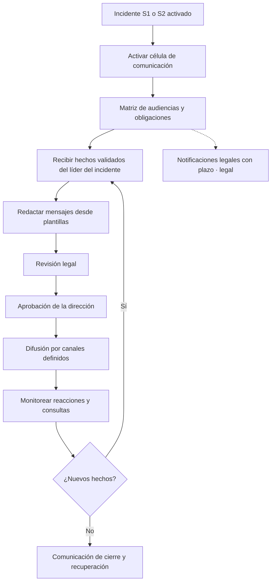

| Control del documento | |
|---|---|
| **Código** | SOP-COM-01 |
| **Versión** | 1.0 |
| **Estado** | Plantilla comunitaria · adaptar antes de aprobar |
| **Dueño del proceso** | Responsable de comunicaciones corporativas junto con el CISO |
| **Aprobado por** | _(cargo que aprueba en tu organización)_ |
| **Fecha de aprobación** | AAAA-MM-DD |
| **Próxima revisión** | 12 meses después de la aprobación, o tras un incidente relevante |
| **Clasificación** | TLP:CLEAR (plantilla) · TLP:AMBER una vez adaptada con datos internos |

# SOP-COM-01 · Comunicaciones de ciberseguridad y crisis

## 1. Objetivo
Asegurar que la información sobre ciberseguridad llegue a las personas correctas, en el momento oportuno, con mensajes veraces y aprobados, tanto durante incidentes como en la gestión ordinaria.

## 2. Alcance
- **Parte A · Incidentes y crisis:** comunicación interna, a la dirección, a clientes, a titulares de datos, a reguladores y autoridades, a medios y en redes sociales.
- **Parte B · Comunicación ordinaria:** informes periódicos a la dirección, alertas a usuarios y intercambio con comunidades.

## 3. Roles y responsabilidades

| Actividad | Líder del incidente | CISO | Comunicaciones | Legal y protección de datos | Dirección | Vocero |
|---|---|---|---|---|---|---|
| Hechos técnicos validados | R | A | I | I | | |
| Redacción de mensajes | C | C | R | C | | C |
| Aprobación de mensajes externos | C | C | C | C | A | |
| Notificación a reguladores y titulares | C | C | C | R | A | |
| Declaraciones públicas | | C | C | C | A | R |
| Comunicación interna | C | C | R | | A | |
| Informes periódicos a la dirección | | R/A | C | | I | |

## 4. Principios
1. **Veracidad:** solo hechos confirmados; lo que no se sabe se dice como tal.
2. **Un solo vocero:** nadie más declara en nombre de la organización.
3. **Sin especular** sobre autores, montos o causas antes de tenerlos confirmados.
4. **Sin detalles que ayuden al atacante** o expongan a otras víctimas.
5. **Coherencia:** el mismo hecho se comunica igual a todas las audiencias.
6. **Oportunidad:** comunicar tarde suele dañar más que comunicar con información incompleta.
7. **Registro:** toda comunicación queda registrada.

## 5. Entradas y salidas
| Entradas | Salidas |
|---|---|
| Hechos validados del incidente | Mensajes aprobados por audiencia |
| Requisitos legales y contractuales de notificación | Notificaciones a autoridades y titulares |
| Informes de inteligencia y métricas | Informes periódicos a la dirección |
| Consultas de medios, clientes y empleados | Registro de comunicaciones |

## PARTE A · Incidentes y crisis

### Paso A1 · Activación
Se activa con todo incidente **S1 o S2**, o S3 con exposición pública o de datos personales. Se conforma la célula: comunicaciones, CISO o su delegado, legal y el vocero.

### Paso A2 · Matriz de audiencias

| Audiencia | Cuándo | Responsable | Canal | Plazo de referencia |
|---|---|---|---|---|
| Dirección | Siempre en S1–S2 | CISO | Llamada + resumen escrito | 1 h (S1) · 4 h (S2) |
| Empleados | Si se les pide acción o hay impacto visible | Comunicaciones | Canal interno alterno si el correo está afectado | Lo antes posible |
| Autoridad de protección de datos | Si hay datos personales con riesgo para los titulares | Legal | Canal oficial de la autoridad | **Según la ley de cada país** (ver [tabla](../incident-response/data-breach/README.md#notificaciones-en-latam)) |
| Regulador sectorial | Según la norma del sector | Legal / cumplimiento | Canal oficial | Según la norma |
| CSIRT nacional | Cuando corresponda o se requiera apoyo | Líder del incidente | Canal del CSIRT | Lo antes posible |
| Titulares de datos | Si la ley o el riesgo lo exigen | Legal + comunicaciones | Correo, carta, aviso público | Según la ley |
| Clientes y socios | Si su servicio o datos están afectados | Comunicaciones + áreas comerciales | Canal verificado | Según contrato |
| Aseguradora | Si hay póliza | Legal / finanzas | Según póliza | Según póliza |
| Medios y redes | Si hay exposición pública | Vocero | Comunicado | Tras aprobación |
| Autoridades judiciales | Denuncia | Legal | Canal oficial | Según decisión |

### Paso A3 · Hechos validados
El líder del incidente entrega un resumen de hechos confirmados (qué, cuándo, qué sistemas, qué datos, qué se hizo). La comunicación **no** usa información no validada.

### Paso A4 · Redacción
Partir de plantillas preaprobadas. Todo mensaje externo responde: qué pasó, qué hicimos, qué significa para el destinatario, qué debe hacer, dónde obtener más información.

### Paso A5 · Revisión y aprobación
Legal revisa todo mensaje externo; la dirección lo aprueba. En S1, el proceso de aprobación no debe superar 1 h.

### Paso A6 · Difusión
Por los canales definidos. Si el correo o la red están comprometidos, usar **canales fuera de banda** acordados de antemano.

### Paso A7 · Monitoreo
Monitorear medios, redes sociales, foros y consultas de clientes; preparar respuestas a preguntas frecuentes y escalar rumores o filtraciones a la célula.

### Paso A8 · Actualizaciones y cierre
Actualizar a las audiencias con la frecuencia comprometida. Al cierre, comunicar la recuperación y las medidas tomadas.

### Paso A9 · Lecciones aprendidas
La revisión post-incidente incluye la comunicación: tiempos, coherencia, recepción de los mensajes.

## PARTE B · Comunicación ordinaria

| Comunicación | Audiencia | Frecuencia | Responsable | Contenido |
|---|---|---|---|---|
| Informe de ciberseguridad | Dirección / comité | Trimestral | CISO | Riesgos principales, incidentes, indicadores, avance del plan, decisiones requeridas |
| Tablero de indicadores | Gestión de seguridad | Mensual | CISO | SOC, vulnerabilidades, incidentes, madurez |
| Alertas a usuarios | Empleados | Según campañas | Seguridad + comunicaciones | Qué está circulando, cómo reconocerlo, cómo reportarlo |
| Concientización | Empleados | Mensual | Seguridad + comunicaciones | Temas prácticos y casos de la región |
| Intercambio con comunidades | ISAC, CSIRT, comunidades | Continuo | Inteligencia | Indicadores y lecciones bajo TLP, anonimizados |

## 6. Tiempos objetivo
Ver la matriz de audiencias (Parte A) y la tabla de la Parte B. Los plazos legales prevalecen sobre cualquier plazo interno.

## 7. Registros
Registro de comunicaciones del incidente (fecha, audiencia, canal, versión, aprobador), notificaciones y acuses de recibo de autoridades, informes periódicos.

## 8. Indicadores
- Cumplimiento de plazos de notificación legal (%).
- Tiempo desde la activación hasta el primer mensaje a la dirección y a empleados.
- Mensajes externos emitidos sin aprobación (objetivo: 0).
- Informes trimestrales entregados en plazo.

## 9. Excepciones
Si un plazo legal está por vencer sin toda la información, se envía una **notificación preliminar** con lo disponible, cuando la norma lo permite, y se completa después.

## 10. Traspasos
| Entrega a | Qué | Recibe de | Qué |
|---|---|---|---|
| Dirección | Mensajes para aprobar e informes | Respuesta a incidentes | Hechos validados |
| Respuesta a incidentes | Consultas y señales externas | Inteligencia | Insumos para informes y alertas |
| Inteligencia | Información recibida de terceros | Vulnerabilidades | Riesgos críticos para la dirección |

## 11. Preparación
- [ ] Plantillas preaprobadas: comunicado público, mensaje interno, notificación a autoridad, aviso a titulares, mensaje a clientes.
- [ ] Vocero y suplente designados y entrenados.
- [ ] Lista de contactos actualizada (autoridades, CSIRT, aseguradora, asesores) también en formato offline.
- [ ] Canales fuera de banda probados.
- [ ] Tabla de obligaciones de notificación por país y sector.
- [ ] Ejercicio anual que incluya comunicación.

## 12. Referencias
NIST CSF 2.0 RS.CO y RC.CO · NIST SP 800-61r3 · ISO 22361 · SIM3 P-2 y H-6 · CISA CPG 2.0 · [Madurez COM](../maturity-assessment/communications/)

## Historial de cambios
| Versión | Fecha | Cambio | Autor |
|---|---|---|---|
| 1.0 | AAAA-MM-DD | Versión inicial a partir de la plantilla comunitaria CIAC | |
