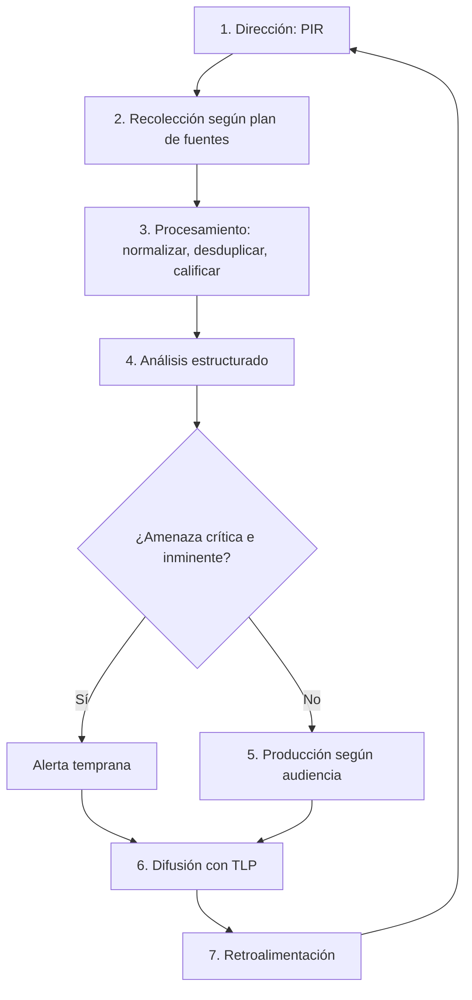

| Control del documento | |
|---|---|
| **Código** | SOP-CTI-01 |
| **Versión** | 1.0 |
| **Estado** | Plantilla comunitaria · adaptar antes de aprobar |
| **Dueño del proceso** | Líder de inteligencia de amenazas |
| **Aprobado por** | _(cargo que aprueba en tu organización)_ |
| **Fecha de aprobación** | AAAA-MM-DD |
| **Próxima revisión** | 12 meses después de la aprobación, o tras un incidente relevante |
| **Clasificación** | TLP:CLEAR (plantilla) · TLP:AMBER una vez adaptada con datos internos |

# SOP-CTI-01 · Ciclo de inteligencia de amenazas

## 1. Objetivo
Producir inteligencia de amenazas oportuna, relevante y accionable para las partes interesadas de la organización, siguiendo el ciclo de inteligencia de forma repetible y medible.

## 2. Alcance
Inteligencia estratégica (dirección), operacional (gestión de seguridad) y táctica (SOC, cacería, vulnerabilidades), incluidas las alertas tempranas y las solicitudes de información.

## 3. Roles y responsabilidades

| Actividad | Líder CTI | Analista CTI | Partes interesadas | SOC / Cacería / Vulnerabilidades | Dirección |
|---|---|---|---|---|---|
| Definir requerimientos (PIR) | R | C | C | C | A |
| Recolección y procesamiento | A | R | | | |
| Análisis y producción | A | R | | C | |
| Difusión | A | R | I | I | I |
| Retroalimentación | R | C | R | R | C |
| Alerta temprana | A | R | I | I | I |

## 4. Definiciones
- **PIR:** requerimientos prioritarios de inteligencia; las preguntas que la organización necesita responder.
- **RFI:** solicitud puntual de información de una parte interesada.
- **Alerta temprana (flash):** aviso urgente sobre una amenaza con impacto probable a corto plazo.
- **Escala Almirantazgo:** calificación de confiabilidad de la fuente (A–F) y credibilidad de la información (1–6).

## 5. Entradas y salidas
| Entradas | Salidas |
|---|---|
| PIR aprobados | Alertas tempranas |
| Fuentes abiertas, comerciales, comunidades, CSIRT nacional | Boletín semanal operativo/táctico |
| Telemetría e incidentes propios | Informe mensual y evaluación estratégica trimestral |
| RFI de partes interesadas | Respuestas a RFI |
| Hallazgos de cacería e incidentes | Indicadores y TTP para detección y cacería |

## 6. Procedimiento

### Paso 1 · Dirección
1. Definir los PIR con dirección, riesgos, SOC, respuesta a incidentes y vulnerabilidades. Ejemplos: ¿qué actores atacan nuestro sector en la región?, ¿qué vulnerabilidades de nuestra tecnología se explotan activamente?, ¿se están vendiendo accesos o datos de la organización?
2. Aprobar los PIR y revisarlos **cada año** o ante un cambio relevante.

### Paso 2 · Recolección
1. Mantener un **plan de fuentes** vinculado a los PIR: fuentes abiertas, comunidades, CSIRT nacional, reguladores, proveedores, telemetría propia.
2. Calificar cada fuente con la escala Almirantazgo y revisar la calificación cada 6 meses.
3. Monitoreo diario de fuentes prioritarias.

### Paso 3 · Procesamiento
Normalizar formatos, desduplicar, traducir, extraer entidades (indicadores, CVE, técnicas ATT&CK, actores) y registrar en la plataforma de inteligencia.

### Paso 4 · Análisis
1. Responder a los PIR, no acumular datos.
2. Usar técnicas estructuradas: Modelo de Diamante, mapeo ATT&CK, ACH cuando hay hipótesis en competencia.
3. Separar hechos de valoraciones; expresar las valoraciones con **lenguaje estimativo** y nivel de confianza.
4. Evaluar relevancia e impacto para la organización: ¿nos afecta?, ¿qué tenemos expuesto?, ¿qué hacemos?

### Paso 5 · Producción

| Producto | Audiencia | Frecuencia | Contenido mínimo |
|---|---|---|---|
| Alerta temprana | SOC, TI, seguridad | Según evento | Qué pasa, a quién afecta, qué hacer ya, indicadores |
| Boletín operativo | Seguridad, SOC, vulnerabilidades | Semanal | Amenazas relevantes, vulnerabilidades explotadas, recomendaciones |
| Paquete táctico | SOC, cacería, detección | Según disponibilidad | Indicadores, TTP, consultas o reglas sugeridas |
| Informe mensual | Gestión de seguridad | Mensual | Tendencias, incidentes del sector, estado de los PIR |
| Evaluación estratégica | Dirección | Trimestral | Panorama de riesgo, implicaciones para el negocio, decisiones sugeridas |
| Respuesta a RFI | Solicitante | Según plazo acordado | Respuesta a la pregunta y nivel de confianza |

### Paso 6 · Difusión
1. Marcar cada producto con **TLP 2.0** y respetar la marca recibida de la fuente.
2. Usar listas de distribución por audiencia; nunca reenviar material TLP:AMBER o TLP:RED fuera de lo permitido.
3. Compartir con comunidades (ISAC, CSIRT nacional, comunidades regionales) lo que sea útil y esté permitido, anonimizado.

### Paso 7 · Retroalimentación
1. Pedir retroalimentación breve en cada producto (¿fue útil?, ¿qué acción generó?).
2. Revisión trimestral con las partes interesadas: cumplimiento de PIR y ajustes.

### Subproceso · Alerta temprana
Se emite cuando una amenaza: (a) se explota activamente, (b) afecta tecnología o sector de la organización y (c) requiere acción en horas. El líder CTI aprueba; en su ausencia, el líder del SOC.

### Subproceso · Solicitudes de información (RFI)
1. Registrar la RFI con pregunta, solicitante, plazo y clasificación.
2. Confirmar el alcance con el solicitante.
3. Responder en el plazo acordado; si no hay respuesta posible, decirlo con lo que se sabe y lo que falta.

## 7. Tiempos objetivo (ejemplo)
| Producto | Plazo |
|---|---|
| Alerta temprana | 4 h desde la identificación |
| RFI urgente | 24 h |
| RFI normal | 5 días hábiles |
| Boletín semanal | Mismo día de cada semana |

## 8. Registros
PIR aprobados, plan de fuentes con calificación, productos emitidos con su TLP y lista de distribución, RFI y respuestas, retroalimentación.

## 9. Indicadores
- PIR con respuesta en el período (%).
- Productos emitidos por tipo y puntualidad.
- Acciones generadas por la inteligencia (detecciones, cacerías, parches priorizados, bloqueos).
- Satisfacción de las partes interesadas.
- Tiempo medio de respuesta a RFI.

## 10. Excepciones
Si una fuente solicita una restricción mayor a la habitual (p. ej. TLP:RED), se respeta aunque limite la difusión; el líder CTI decide cómo comunicar la acción necesaria sin revelar la información.

## 11. Traspasos
| Entrega a | Qué | Recibe de | Qué |
|---|---|---|---|
| Cacería | Hipótesis y contexto | Cacería | TTP descubiertos |
| Casos de uso y detecciones | TTP e indicadores | Respuesta a incidentes | Lecciones y TTP observados |
| Vulnerabilidades | Explotación activa y actores interesados | SOC | Indicadores observados |
| Comunicaciones | Insumos para informes a la dirección | Partes interesadas | PIR y RFI |

## 12. Referencias
NIST SP 800-150 · CTI-CMM · FIRST TLP 2.0 · [Metodologías OSINT](../threat-intelligence/OSINT/) · [ACH](../threat-intelligence/ACH/) · [Madurez CTI](../maturity-assessment/cti/)

## Historial de cambios
| Versión | Fecha | Cambio | Autor |
|---|---|---|---|
| 1.0 | AAAA-MM-DD | Versión inicial a partir de la plantilla comunitaria CIAC | |
