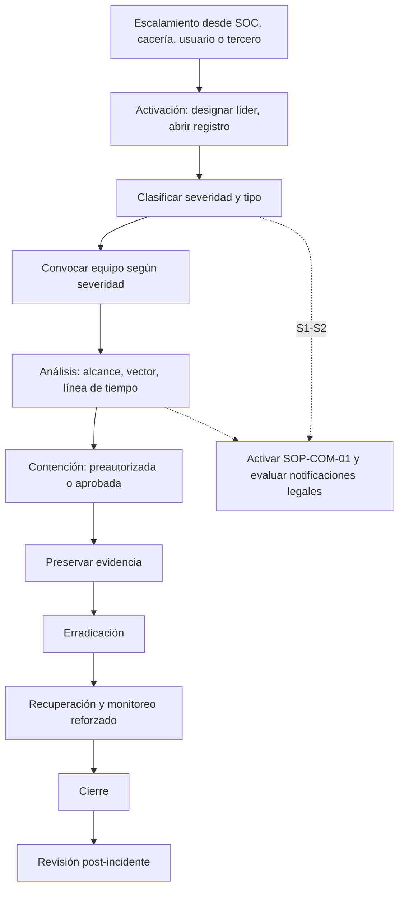

| Control del documento | |
|---|---|
| **Código** | SOP-IR-01 |
| **Versión** | 1.0 |
| **Estado** | Plantilla comunitaria · adaptar antes de aprobar |
| **Dueño del proceso** | Líder de respuesta a incidentes |
| **Aprobado por** | _(cargo que aprueba en tu organización)_ |
| **Fecha de aprobación** | AAAA-MM-DD |
| **Próxima revisión** | 12 meses después de la aprobación, o tras un incidente relevante |
| **Clasificación** | TLP:CLEAR (plantilla) · TLP:AMBER una vez adaptada con datos internos |

# SOP-IR-01 · Respuesta a incidentes

## 1. Objetivo
Gestionar los incidentes de seguridad de forma coordinada para limitar su impacto, restablecer las operaciones, cumplir las obligaciones legales y aprender de cada caso.

## 2. Alcance
Todo incidente de seguridad confirmado o altamente probable que afecte a la organización, sus datos o sus servicios, incluidos los ocurridos en proveedores que traten sus datos. Los pasos específicos por tipo de incidente están en los [playbooks](../incident-response/).

## 3. Roles y responsabilidades

| Actividad | Líder del incidente | Analistas de respuesta / forense | TI y dueños de activos | Legal y protección de datos | Comunicaciones | Dirección |
|---|---|---|---|---|---|---|
| Activación y clasificación | R/A | C | I | I | I | I (S1–S2) |
| Análisis | A | R | C | | | |
| Contención | A | R | R | C | | C (impacto al negocio) |
| Preservación de evidencia | A | R | C | C | | |
| Erradicación y recuperación | A | C | R | | | I |
| Notificaciones legales | C | C | | R | C | A |
| Comunicación interna y externa | C | | | C | R | A |
| Cierre y lecciones aprendidas | R/A | R | C | C | C | I |

**Líder del incidente:** una sola persona coordina y toma decisiones operativas. Puede delegar, pero no compartir, el rol.

## 4. Definiciones
- **Evento:** suceso observable en un sistema.
- **Incidente:** evento que compromete o amenaza la confidencialidad, integridad o disponibilidad de la información o los servicios.
- **Acción preautorizada:** medida de contención que el equipo puede ejecutar sin pedir aprobación (aislar un equipo, deshabilitar una cuenta, bloquear un indicador).

## 5. Clasificación de severidad

| Severidad | Criterios (cualquiera) | Activación |
|---|---|---|
| **S1 · Crítica** | Cifrado o destrucción en curso · exfiltración confirmada de datos sensibles · compromiso de cuentas privilegiadas o del dominio · interrupción de servicios críticos | Equipo completo, dirección, legal y comunicaciones de inmediato |
| **S2 · Alta** | Compromiso confirmado de uno o pocos activos · malware activo · cuenta comprometida sin privilegios · riesgo de escalar a S1 | Equipo de respuesta; dirección y legal informados |
| **S3 · Media** | Intento con impacto limitado o contenido · phishing con clic sin evidencia de compromiso | Analistas de respuesta |
| **S4 · Baja** | Violación de política sin impacto · intento bloqueado de interés | Gestión normal del SOC |

La severidad se **reevalúa** en cada reunión de seguimiento; puede subir o bajar.

## 6. Procedimiento

### Paso 1 · Activación
1. Designar al **líder del incidente** y abrir el **registro del incidente** con fecha y hora de conocimiento (inicia plazos legales).
2. Crear un canal de coordinación, **fuera de banda** si se sospecha compromiso del correo o la red.

### Paso 2 · Clasificación
Asignar severidad (tabla del punto 5) y tipo; seleccionar el [playbook](../incident-response/) aplicable (ransomware, phishing, BEC, fuga o brecha de datos).

### Paso 3 · Convocatoria
Según la severidad. Para S1–S2 se activa además el [SOP-COM-01](SOP-COM-01-comunicaciones.md) y se informa a legal para evaluar notificaciones.

### Paso 4 · Análisis
Determinar: activos y cuentas afectados, vector de acceso inicial, técnicas ATT&CK, datos involucrados, línea de tiempo y si el atacante sigue presente. Pedir a inteligencia contexto sobre el actor y a cacería búsquedas en el resto del entorno.

### Paso 5 · Contención
1. Ejecutar **acciones preautorizadas** sin demora e informarlas.
2. Acciones con impacto en el negocio (desconectar un servicio, cortar un enlace) las aprueba el líder del incidente con el dueño del servicio; en S1, la dirección.
3. Preferir contener sin apagar equipos para no perder evidencia volátil.

### Paso 6 · Preservación de evidencia
Antes o durante la contención, según el riesgo: memoria y disco de equipos clave, registros relevantes, con **hash** y **cadena de custodia**.

### Paso 7 · Erradicación
Eliminar persistencia, herramientas y cuentas del atacante; cerrar el vector de acceso; restablecer credenciales comprometidas.

### Paso 8 · Recuperación
Restaurar desde fuentes verificadas como limpias, en el orden de prioridad del negocio; monitoreo reforzado durante al menos 30 días.

### Paso 9 · Seguimiento y registro
| Severidad | Reunión de seguimiento | Informe a la dirección |
|---|---|---|
| S1 | Cada 2–4 h | Cada reunión |
| S2 | Diaria | Diario |
| S3 | Según avance | Al cierre |

El registro del incidente documenta cronológicamente cada hallazgo, decisión (quién y por qué) y acción.

### Paso 10 · Cierre
Se cierra cuando: el atacante fue erradicado, los servicios están recuperados, las notificaciones se completaron y hay plan de acción para las causas.

### Paso 11 · Revisión post-incidente
En un máximo de **10 días hábiles** para S1–S2: qué pasó, qué funcionó, qué no, causa raíz y acciones con responsable y fecha. Sin buscar culpables. Informe con la [plantilla](../templates/incident-report.md).

## 7. Tiempos objetivo (ejemplo)
| Hito | S1 | S2 | S3 |
|---|---|---|---|
| Líder designado desde el escalamiento | 15 min | 30 min | 4 h |
| Primera contención | 1 h | 4 h | 24 h |
| Primer informe a la dirección | 1 h | 4 h | Al cierre |
| Revisión post-incidente | 10 días hábiles | 10 días hábiles | Opcional |

## 8. Registros
Registro del incidente, evidencias con cadena de custodia, comunicaciones y notificaciones enviadas, informe final. Retención según política y requisitos legales (se recomienda al menos 5 años para incidentes con datos personales).

## 9. Indicadores
- Tiempo de detección, de contención y de recuperación por severidad.
- Incidentes por tipo, severidad y vector.
- Cumplimiento de plazos de notificación legal.
- Acciones post-incidente cerradas en plazo (%).
- Incidentes recurrentes por la misma causa.

## 10. Excepciones
Si el líder del incidente no está disponible, asume su suplente designado. Si el incidente afecta al propio equipo de seguridad o a sus herramientas, se activa apoyo externo.

## 11. Traspasos
| Entrega a | Qué | Recibe de | Qué |
|---|---|---|---|
| Comunicaciones | Hechos validados para mensajes | SOC | Incidentes escalados |
| Inteligencia | TTP e indicadores observados | Cacería | Actividad maliciosa |
| Casos de uso y detecciones | Brechas de detección | Inteligencia | Contexto del actor |
| Vulnerabilidades | Vulnerabilidades explotadas | Terceros | Avisos de CSIRT, proveedores, autoridades |

## 12. Referencias
NIST SP 800-61r3 · NIST SP 800-86 · ISO/IEC 27035 · ISO/IEC 27037 · SIM3 · CISA *Incident & Vulnerability Response Playbooks* · [Playbooks](../incident-response/) · [Madurez IR](../maturity-assessment/incident-response/)

## Historial de cambios
| Versión | Fecha | Cambio | Autor |
|---|---|---|---|
| 1.0 | AAAA-MM-DD | Versión inicial a partir de la plantilla comunitaria CIAC | |
