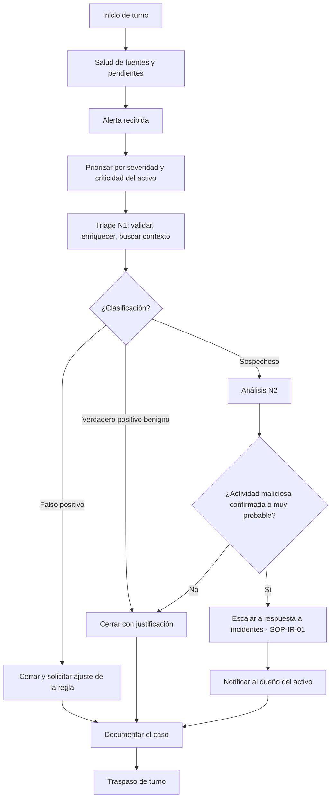

| Control del documento | |
|---|---|
| **Código** | SOP-SOC-01 |
| **Versión** | 1.0 |
| **Estado** | Plantilla comunitaria · adaptar antes de aprobar |
| **Dueño del proceso** | Gerente o líder del SOC |
| **Aprobado por** | _(cargo que aprueba en tu organización)_ |
| **Fecha de aprobación** | AAAA-MM-DD |
| **Próxima revisión** | 12 meses después de la aprobación, o tras un incidente relevante |
| **Clasificación** | TLP:CLEAR (plantilla) · TLP:AMBER una vez adaptada con datos internos |

# SOP-SOC-01 · Monitoreo, triage y escalamiento de alertas

## 1. Objetivo
Asegurar que toda alerta de seguridad se atienda, analice, clasifique y, cuando corresponda, se escale a respuesta a incidentes dentro de los tiempos acordados, dejando registro trazable.

## 2. Alcance
Alertas generadas por SIEM, EDR/XDR, seguridad de correo, identidad, nube, red y reportes de usuarios. No cubre la gestión del incidente una vez escalado (ver [SOP-IR-01](SOP-IR-01-respuesta-a-incidentes.md)).

## 3. Roles y responsabilidades

| Actividad | Analista N1 | Analista N2 | Líder de turno | Ingeniería de detección | Respuesta a incidentes | Dueño del activo |
|---|---|---|---|---|---|---|
| Revisión de salud de fuentes | R | I | A | C | | |
| Triage inicial | R | C | A | | | |
| Análisis profundo | I | R | A | C | | C |
| Escalamiento a incidente | C | R | A | | I | I |
| Notificación al dueño del activo | | R | A | | | I |
| Ajuste de detecciones por falsos positivos | C | C | I | R/A | | |
| Traspaso de turno | R | R | A | | | |

## 4. Definiciones
- **Alerta:** señal automática o reporte que indica una posible actividad maliciosa.
- **Caso:** registro en el sistema de tickets que agrupa una o varias alertas relacionadas.
- **Falso positivo:** la detección se activó, pero la actividad no corresponde a lo que la regla busca.
- **Verdadero positivo benigno:** la actividad es la que la regla busca, pero es legítima y autorizada (p. ej. una prueba de penetración).
- **Verdadero positivo malicioso:** actividad maliciosa confirmada → se escala como incidente.

## 5. Entradas y salidas
| Entradas | Salidas |
|---|---|
| Alertas de las plataformas de seguridad | Casos documentados y clasificados |
| Reportes de usuarios (buzón de phishing, mesa de ayuda) | Incidentes escalados a respuesta |
| Inteligencia de amenazas y avisos | Notificaciones a dueños de activos |
| Lista de activos críticos y contactos | Solicitudes de ajuste de detecciones |
| | Informe de turno y métricas |

## 6. Procedimiento

### Paso 1 · Inicio de turno
1. Leer el informe del turno anterior y revisar los casos abiertos.
2. Verificar la **salud de las fuentes**: cada fuente crítica envió datos en la última hora. Una fuente silenciosa se trata como alerta S3 y se avisa a la plataforma o al dueño.
3. Revisar avisos de inteligencia recibidos desde el último turno.

### Paso 2 · Priorización
Ordenar la cola por: severidad de la regla → criticidad del activo → antigüedad. Ante dos alertas de igual severidad, primero la del activo crítico.

### Paso 3 · Triage (N1)
1. Tomar la alerta en el sistema (registra el **tiempo de reconocimiento**).
2. Validar que no sea duplicada ni ya atendida.
3. Enriquecer: usuario y activo involucrados, reputación de indicadores, actividad previa del mismo usuario o equipo, técnica ATT&CK.
4. Revisar el procedimiento específico de la regla (*runbook*), si existe.
5. Clasificar: falso positivo · verdadero positivo benigno · sospechoso.
6. Si es sospechoso o no se puede descartar en **20 minutos**, escalar a N2.

### Paso 4 · Análisis (N2)
1. Revisar la línea de tiempo del activo y del usuario (proceso padre, línea de comandos, conexiones, inicios de sesión).
2. Buscar la misma actividad en otros activos.
3. Determinar si hay actividad maliciosa confirmada o muy probable.
4. Si se confirma → paso 5. Si no → cerrar con justificación detallada.

### Paso 5 · Escalamiento
Se escala a respuesta a incidentes cuando se cumple **cualquiera** de estas condiciones:
- Actividad maliciosa confirmada en un activo.
- Indicios de movimiento lateral, robo de credenciales, exfiltración o cifrado.
- Compromiso de cuenta privilegiada o de un activo crítico.
- Solicitud de un tercero autorizado (CSIRT nacional, proveedor, regulador).

El escalamiento incluye: resumen, activos y cuentas, técnicas observadas, indicadores, acciones ya tomadas y severidad propuesta. Si existen **acciones de contención preautorizadas** (aislar equipo, deshabilitar cuenta), el N2 las ejecuta y las informa.

### Paso 6 · Notificación
Notificar al dueño del activo por el canal definido, con lo que se sabe, lo que se le pide hacer y lo que no debe hacer (p. ej. no apagar el equipo).

### Paso 7 · Documentación y cierre
Todo caso registra: clasificación, evidencia revisada, razonamiento, acciones y tiempo invertido. **Ningún caso se cierra sin justificación.**

### Paso 8 · Ajuste de detecciones
Los falsos positivos recurrentes generan una solicitud a ingeniería de detección ([SOP-SOC-02](SOP-SOC-02-gestion-de-casos-de-uso.md)). Nunca se desactiva una regla desde el turno sin aprobación del líder.

### Paso 9 · Traspaso de turno
Informe con: casos abiertos y su estado, incidentes activos, fuentes con problemas, avisos relevantes y tareas pendientes.

## 7. Tiempos objetivo (ejemplo)

| Severidad | Reconocimiento | Triage completo | Escalamiento / notificación |
|---|---|---|---|
| S1 | 15 min | 30 min | 30 min |
| S2 | 30 min | 1 h | 2 h |
| S3 | 2 h | 8 h | 8 h |
| S4 | 8 h | 24 h | Informe periódico |

## 8. Registros
Casos en el sistema de tickets, informes de turno y registros de las plataformas, retenidos según la política de retención (mínimo recomendado: 12 meses para casos).

## 9. Indicadores
- Tiempo medio de reconocimiento y de triage por severidad.
- Cumplimiento de tiempos objetivo (%).
- Tasa de falsos positivos por regla.
- Casos escalados a incidente (%).
- Fuentes críticas sin datos y tiempo sin datos.
- Alertas por analista y turno (carga de trabajo).

## 10. Excepciones
- Volumen extraordinario: el líder de turno prioriza solo S1–S2 y activa refuerzos.
- Caída de plataforma: se activa el procedimiento de continuidad y se revisan los registros pendientes al restablecerse.

## 11. Traspasos
| Entrega a | Qué | Recibe de | Qué |
|---|---|---|---|
| Respuesta a incidentes | Incidentes escalados | Casos de uso y detecciones | Reglas y runbooks |
| Casos de uso y detecciones | Falsos positivos y brechas | Inteligencia | Avisos e indicadores |
| Inteligencia | Indicadores observados | Cacería | Nuevas detecciones |
| Comunicaciones | Alertas a usuarios cuando hay campañas activas | | |

## 12. Referencias
NIST SP 800-61r3 · NIST SP 800-137 · CISA *Implementing SIEM and SOAR Platforms* · SOC-CMM · [Evaluación de madurez SOC-07, SOC-09](../maturity-assessment/soc/)

## Historial de cambios
| Versión | Fecha | Cambio | Autor |
|---|---|---|---|
| 1.0 | AAAA-MM-DD | Versión inicial a partir de la plantilla comunitaria CIAC | |
