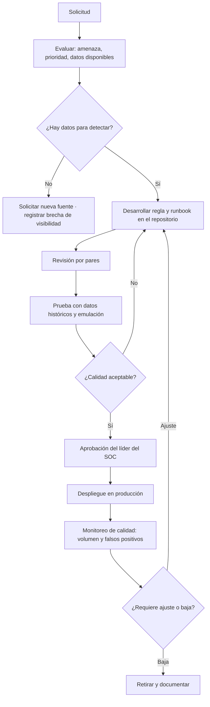

| Control del documento | |
|---|---|
| **Código** | SOP-SOC-02 |
| **Versión** | 1.0 |
| **Estado** | Plantilla comunitaria · adaptar antes de aprobar |
| **Dueño del proceso** | Responsable de ingeniería de detección |
| **Aprobado por** | _(cargo que aprueba en tu organización)_ |
| **Fecha de aprobación** | AAAA-MM-DD |
| **Próxima revisión** | 12 meses después de la aprobación, o tras un incidente relevante |
| **Clasificación** | TLP:CLEAR (plantilla) · TLP:AMBER una vez adaptada con datos internos |

# SOP-SOC-02 · Gestión de casos de uso y detecciones

## 1. Objetivo
Gestionar el ciclo de vida de los casos de uso de detección (alta, prueba, despliegue, ajuste y baja) para que cada regla tenga un propósito, un dueño, un procedimiento de atención y una calidad medida.

## 2. Alcance
Reglas de SIEM, EDR/XDR, correo, red y nube, y sus procedimientos de atención (*runbooks*). Basado en el ciclo de vida de **MaGMa** y en el enfoque **Detection as Code**.

## 3. Roles y responsabilidades

| Actividad | Ingeniería de detección | Líder del SOC | Analistas | Inteligencia | Cacería | Dueño de plataforma |
|---|---|---|---|---|---|---|
| Solicitud de caso de uso | C | I | R | R | R | |
| Diseño y desarrollo | R | I | C | C | C | C |
| Pruebas | R | I | C | | | C |
| Aprobación para producción | C | A | I | | | I |
| Ajuste por falsos positivos | R | A | C | | | |
| Baja | R | A | I | I | I | |

## 4. Definiciones
- **Caso de uso:** amenaza a detectar + lógica de detección + fuentes de datos + procedimiento de atención.
- **Runbook:** guía de atención específica de una regla para el analista.
- **Estados:** `propuesto` → `en desarrollo` → `en prueba` → `producción` → `retirado`.

## 5. Entradas y salidas
| Entradas | Salidas |
|---|---|
| Solicitudes de analistas, inteligencia, cacería, incidentes | Reglas versionadas en repositorio |
| Brechas de cobertura ATT&CK | Runbooks por regla |
| Reportes de falsos positivos | Inventario de casos de uso actualizado |
| Cambios en el negocio o la infraestructura | Mapa de cobertura ATT&CK |

## 6. Procedimiento

### Paso 1 · Solicitud
Cualquier rol puede solicitar un caso de uso indicando: amenaza o técnica ATT&CK, motivación (inteligencia, incidente, cacería, regulación), activos afectados y prioridad sugerida.

### Paso 2 · Evaluación y priorización
Priorizar según: relevancia para actores que atacan el sector y la región, criticidad de los activos, cobertura actual de la técnica, y esfuerzo.

### Paso 3 · Desarrollo
1. Escribir la lógica, preferentemente en **Sigma**, y convertirla a la plataforma.
2. Guardar la regla en el **repositorio** con control de versiones: nunca editar directamente en producción.
3. Escribir el runbook: qué significa la alerta, cómo validarla, falsos positivos conocidos, cuándo escalar.
4. Asignar severidad y técnica ATT&CK.

### Paso 4 · Revisión y prueba
1. Revisión por un par.
2. Ejecutar la regla sobre al menos **30 días de datos históricos** para estimar volumen y falsos positivos.
3. Validar que detecta la técnica con una **emulación** controlada en un equipo de prueba.
4. Criterio orientativo de aceptación: volumen manejable por el equipo y tasa de falsos positivos acordada.

### Paso 5 · Aprobación y despliegue
El líder del SOC aprueba. Se despliega en modo *producción* y se informa a los analistas con el runbook.

### Paso 6 · Monitoreo de calidad
Revisión mensual de cada regla: volumen, falsos positivos, casos escalados. Reglas sin alertas en 6 meses se revisan (¿la técnica ya no aplica o la regla dejó de funcionar?).

### Paso 7 · Ajuste
Cambios por falsos positivos siguen el mismo flujo (repositorio, revisión, prueba). Las **exclusiones** se documentan con justificación y fecha de revisión.

### Paso 8 · Baja
Se retira cuando la amenaza o el activo ya no aplican o fue reemplazada. Se documenta el motivo y se actualiza el mapa de cobertura.

## 7. Tiempos objetivo (ejemplo)
| Prioridad | Desde la solicitud hasta producción |
|---|---|
| Urgente (amenaza activa contra el sector) | 48 h |
| Alta | 2 semanas |
| Normal | Próximo ciclo mensual |
| Ajuste por falso positivo recurrente | 5 días hábiles |

## 8. Registros
Repositorio con historial de cambios, inventario de casos de uso, runbooks, resultados de pruebas y aprobaciones.

## 9. Indicadores
- Cobertura de técnicas ATT&CK priorizadas (%).
- Casos de uso nuevos, ajustados y retirados por mes.
- Tasa de falsos positivos por regla.
- Tiempo medio desde la solicitud hasta producción.
- Reglas sin runbook (debe ser 0).

## 10. Excepciones
Ante una amenaza activa crítica, el líder del SOC puede autorizar un despliegue de emergencia con prueba reducida; la prueba completa se hace en los 5 días hábiles siguientes.

## 11. Traspasos
| Entrega a | Qué | Recibe de | Qué |
|---|---|---|---|
| Monitoreo y triage | Reglas y runbooks | Monitoreo y triage | Falsos positivos |
| Inteligencia | Mapa de cobertura | Inteligencia | TTP e indicadores |
| Comunidad | Reglas compartibles en [detection-as-code](../detection-as-code/) | Cacería | Hallazgos convertibles en reglas |
| | | Respuesta a incidentes | Brechas de detección |

## 12. Referencias
MaGMa Use Case Framework · Sigma · MITRE ATT&CK · CISA *Priority Logs for SIEM Ingestion* · [Madurez SOC-08, SOC-12](../maturity-assessment/soc/)

## Historial de cambios
| Versión | Fecha | Cambio | Autor |
|---|---|---|---|
| 1.0 | AAAA-MM-DD | Versión inicial a partir de la plantilla comunitaria CIAC | |
