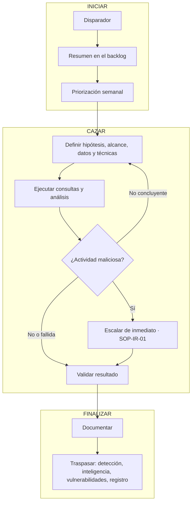

| Control del documento | |
|---|---|
| **Código** | SOP-TH-01 |
| **Versión** | 1.0 |
| **Estado** | Plantilla comunitaria · adaptar antes de aprobar |
| **Dueño del proceso** | Líder de cacería de amenazas |
| **Aprobado por** | _(cargo que aprueba en tu organización)_ |
| **Fecha de aprobación** | AAAA-MM-DD |
| **Próxima revisión** | 12 meses después de la aprobación, o tras un incidente relevante |
| **Clasificación** | TLP:CLEAR (plantilla) · TLP:AMBER una vez adaptada con datos internos |

# SOP-TH-01 · Cacería de amenazas

## 1. Objetivo
Buscar de forma proactiva y estructurada actividad maliciosa que haya evadido los controles existentes, reducir el tiempo de permanencia del atacante y convertir los hallazgos en mejoras de detección y prevención.

## 2. Alcance
Cacerías estructuradas (por hipótesis), por línea base y situacionales sobre la telemetría de la organización. Basado en **TaHiTI** (iniciar, cazar, finalizar) y complementado con **PEAK**. Las cacerías son de **solo lectura**: no modifican sistemas.

## 3. Roles y responsabilidades

| Actividad | Cazador | Líder de cacería | Inteligencia | Ingeniería de detección | Respuesta a incidentes |
|---|---|---|---|---|---|
| Registrar disparadores y resúmenes | R | A | R | C | C |
| Priorizar el backlog | C | R/A | C | C | |
| Definir hipótesis y alcance | R | A | C | | |
| Ejecutar | R | A | C | | |
| Escalar actividad maliciosa | R | A | I | | R |
| Documentar y traspasar | R | A | I | I | I |

## 4. Definiciones
- **Disparador:** motivo para cazar (inteligencia, ATT&CK, incidente, brecha de cobertura, vulnerabilidad explotada).
- **Hipótesis:** afirmación comprobable: *si [comportamiento] ocurre en [alcance], se observará [evidencia] en [fuente]*.
- **Resultado:** probada · refutada · no concluyente · fallida (sin datos).

## 5. Entradas y salidas
| Entradas | Salidas |
|---|---|
| Inteligencia, avisos, MITRE ATT&CK | Informes de cacería |
| Brechas de cobertura de detección | Incidentes escalados |
| Vulnerabilidades explotadas | Nuevas detecciones propuestas |
| Lecciones de incidentes | Brechas de visibilidad y recomendaciones |
| Telemetría centralizada | Nueva inteligencia |

## 6. Procedimiento

### Paso 1 · Disparador y resumen
Registrar en el backlog: título, disparador, técnica ATT&CK, activos o datos involucrados y una prioridad sugerida.

### Paso 2 · Priorización
Revisión **semanal** del backlog con criterios: amenaza activa contra el sector o la región, criticidad de los activos, ausencia de detección automática para la técnica, disponibilidad de datos.

### Paso 3 · Definir
Usar la [plantilla de cacería](../threat-hunting/hunts/_plantilla-hunt.md):
1. Hipótesis comprobable.
2. Alcance: activos, período (p. ej. últimos 30–90 días).
3. Fuentes de datos y verificación de que existen con la calidad necesaria.
4. Técnicas de análisis: consulta, apilamiento, línea base, agrupación, modelos.
5. Duración máxima (*timebox*), p. ej. 2 a 5 días.

### Paso 4 · Ejecutar
1. Ejecutar consultas y análisis, documentando cada una.
2. Usar inteligencia para pivotar hacia técnicas relacionadas.
3. Refinar el alcance o la hipótesis si aparecen omisiones (proceso iterativo).

### Paso 5 · Escalamiento inmediato
Si se encuentra actividad maliciosa probable: **detener la cacería**, no alertar al atacante (no interactuar con su infraestructura ni tocar los equipos), preservar las consultas y resultados, y escalar a respuesta a incidentes con lo encontrado.

### Paso 6 · Validar
Declarar el resultado: probada, refutada, no concluyente o fallida, con justificación.

### Paso 7 · Documentar
Informe con: hipótesis, alcance, consultas, hallazgos, resultado, recomendaciones y lecciones aprendidas.

### Paso 8 · Traspasar
| Hallazgo | Destino |
|---|---|
| Lógica que detecta la actividad | Ingeniería de detección ([SOP-SOC-02](SOP-SOC-02-gestion-de-casos-de-uso.md)) |
| TTP o infraestructura nueva | Inteligencia ([SOP-CTI-01](SOP-CTI-01-ciclo-de-inteligencia.md)) |
| Vulnerabilidad o configuración insegura | Gestión de vulnerabilidades ([SOP-VUL-01](SOP-VUL-01-gestion-de-vulnerabilidades.md)) |
| Falta de datos | Dueño de la plataforma (nueva fuente o campo) |
| Control preventivo ausente | Seguridad / TI |

## 7. Tiempos objetivo (ejemplo)
| Actividad | Objetivo |
|---|---|
| Cacerías completadas | Mínimo 2 por mes (equipo mediano) |
| Cacería situacional ante amenaza activa | Inicio en 24 h |
| Escalamiento de actividad maliciosa | Inmediato |
| Informe tras finalizar | 3 días hábiles |

## 8. Registros
Backlog, informes de cacería con consultas, evidencias preservadas, traspasos realizados.

## 9. Indicadores
- Cacerías completadas por resultado.
- Incidentes iniciados por cacería y tiempo de permanencia del atacante en esos hallazgos.
- Detecciones creadas a partir de cacerías.
- Brechas de visibilidad identificadas y resueltas.
- Nivel en el Hunting Maturity Model.

## 10. Excepciones
Si una cacería requiere recolectar datos adicionales de los equipos (p. ej. artefactos forenses), se pide autorización al dueño del activo y se coordina con respuesta a incidentes.

## 11. Traspasos
| Entrega a | Qué | Recibe de | Qué |
|---|---|---|---|
| Respuesta a incidentes | Actividad maliciosa | Inteligencia | Hipótesis y contexto |
| Casos de uso y detecciones | Nuevas detecciones | Casos de uso | Brechas de cobertura |
| Inteligencia | TTP descubiertos | Vulnerabilidades | Vulnerabilidades explotadas |
| Vulnerabilidades | Configuraciones inseguras | Respuesta a incidentes | Lecciones aprendidas |

## 12. Referencias
TaHiTI · PEAK · Hunting Maturity Model · NIST SP 800-53 RA-10 · [Frameworks de cacería](../threat-hunting/) · [Madurez TH](../maturity-assessment/threat-hunting/)

## Historial de cambios
| Versión | Fecha | Cambio | Autor |
|---|---|---|---|
| 1.0 | AAAA-MM-DD | Versión inicial a partir de la plantilla comunitaria CIAC | |
