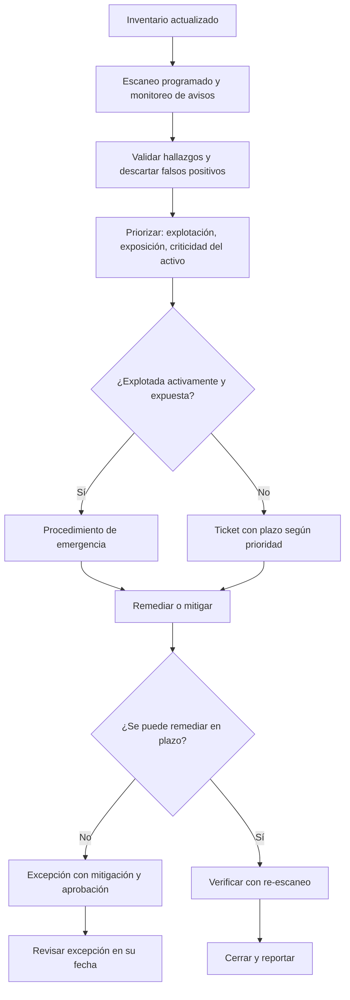

| Control del documento | |
|---|---|
| **Código** | SOP-VUL-01 |
| **Versión** | 1.0 |
| **Estado** | Plantilla comunitaria · adaptar antes de aprobar |
| **Dueño del proceso** | Responsable de gestión de vulnerabilidades |
| **Aprobado por** | _(cargo que aprueba en tu organización)_ |
| **Fecha de aprobación** | AAAA-MM-DD |
| **Próxima revisión** | 12 meses después de la aprobación, o tras un incidente relevante |
| **Clasificación** | TLP:CLEAR (plantilla) · TLP:AMBER una vez adaptada con datos internos |

# SOP-VUL-01 · Gestión de vulnerabilidades

## 1. Objetivo
Identificar, priorizar y remediar las vulnerabilidades de los activos de la organización dentro de plazos definidos según el riesgo, y gestionar de forma explícita el riesgo que no puede remediarse.

## 2. Alcance
Servidores, estaciones de trabajo, equipos de red, nube, aplicaciones propias y de terceros, contenedores y superficie expuesta a Internet.

## 3. Roles y responsabilidades

| Actividad | Gestión de vulnerabilidades | Dueños de activos / TI | Inteligencia | Seguridad (CISO) | Dirección |
|---|---|---|---|---|---|
| Inventario de activos | C | R | | A | |
| Escaneo | R | I | | A | |
| Priorización | R | C | C | A | |
| Remediación | C | R | | A | |
| Excepciones | C | R | | A | A (riesgo alto) |
| Verificación | R | I | | A | |
| Reportes | R | I | | A | I |

## 4. Definiciones
- **KEV:** catálogo de CISA de vulnerabilidades con explotación confirmada.
- **EPSS:** probabilidad estimada de explotación en los próximos 30 días (FIRST).
- **SSVC:** árbol de decisión que asigna una acción: *Track*, *Track\**, *Attend* o *Act*.
- **Excepción:** vulnerabilidad que no se remedia en plazo, con riesgo aceptado formalmente.

## 5. Entradas y salidas
| Entradas | Salidas |
|---|---|
| Inventario de activos con dueño y criticidad | Lista priorizada de vulnerabilidades |
| Resultados de escaneo y de análisis de código | Tickets de remediación |
| Avisos de fabricantes, KEV, EPSS, inteligencia | Registro de excepciones |
| Reportes de investigadores (divulgación) | Reportes e indicadores |

## 6. Procedimiento

### Paso 1 · Inventario
Mantener el inventario con dueño, criticidad y exposición (Internet o interna). Activos nuevos se incorporan al escaneo antes de pasar a producción.

### Paso 2 · Identificación
| Ámbito | Frecuencia mínima sugerida |
|---|---|
| Superficie expuesta a Internet | Semanal y continua |
| Servidores y equipos de red | Quincenal, escaneo autenticado |
| Estaciones de trabajo | Continua (agente) o mensual |
| Aplicaciones propias | En cada versión (SAST, DAST, análisis de dependencias) |
| Nube | Continua con herramientas de postura |

Además, revisar a diario el catálogo KEV y los avisos de los fabricantes usados por la organización.

### Paso 3 · Validación
Descartar falsos positivos con evidencia (versión real, configuración, compensación existente) antes de abrir tickets.

### Paso 4 · Priorización
Combinar: **explotación** (KEV, EPSS, inteligencia) · **exposición** (Internet, interna, aislada) · **criticidad del activo** · **impacto técnico** (CVSS). Una forma práctica es aplicar la decisión **SSVC**:

| Decisión SSVC | Situación típica | Plazo de ejemplo |
|---|---|---|
| **Act** | Explotada activamente, expuesta, activo crítico | 72 h (procedimiento de emergencia) |
| **Attend** | Explotación probable o activo crítico expuesto | 15 días |
| **Track\*** | Requiere seguimiento cercano | 30 días |
| **Track** | Riesgo bajo | Próximo ciclo normal (≤ 90 días) |

### Paso 5 · Remediación
1. Crear ticket con activo, vulnerabilidad, prioridad, plazo y solución sugerida.
2. El dueño del activo remedia (parche, actualización, cambio de configuración) siguiendo la gestión de cambios.
3. Si no hay parche: aplicar **mitigación** (desactivar el servicio, restringir acceso, regla de protección) y registrarla.

### Paso 6 · Procedimiento de emergencia
Se activa ante una vulnerabilidad **explotada activamente** que afecta activos **expuestos o críticos**:
1. Notificar a seguridad, TI y dueños en menos de 4 h desde la identificación.
2. Identificar todos los activos afectados.
3. Aplicar mitigación inmediata y parche en el menor plazo posible (objetivo 72 h).
4. Solicitar a cacería una búsqueda de explotación previa ([SOP-TH-01](SOP-TH-01-caceria-de-amenazas.md)); si hay indicios, escalar a [SOP-IR-01](SOP-IR-01-respuesta-a-incidentes.md).

### Paso 7 · Excepciones
1. Solicitud del dueño con justificación, mitigación compensatoria y fecha de revisión (máximo 6 meses).
2. Aprobación por seguridad; riesgo alto o crítico también por la dirección.
3. Revisión en la fecha; ninguna excepción es permanente.

### Paso 8 · Verificación y cierre
Re-escaneo o prueba que confirme la remediación. El ticket se cierra solo con evidencia.

### Paso 9 · Reportes
Mensual a seguridad y trimestral a la dirección.

## 7. Tiempos objetivo
Ver tabla del paso 4 (ejemplo). Ajustar a la política aprobada.

## 8. Registros
Inventario, resultados de escaneo, tickets con evidencia de cierre, excepciones aprobadas, reportes.

## 9. Indicadores
- Cobertura de escaneo sobre el inventario (%).
- Tiempo medio de remediación por prioridad.
- Vulnerabilidades fuera de plazo (%) y antigüedad.
- Vulnerabilidades KEV abiertas en activos expuestos (objetivo: 0).
- Excepciones vigentes y vencidas.

## 10. Excepciones al procedimiento
Ventanas de congelamiento del negocio (cierres contables, temporadas altas): se acuerdan de antemano y no aplican al procedimiento de emergencia.

## 11. Traspasos
| Entrega a | Qué | Recibe de | Qué |
|---|---|---|---|
| Cacería | Vulnerabilidades explotadas para búsqueda retrospectiva | Inteligencia | Explotación activa y actores |
| Respuesta a incidentes | Indicios de explotación | Respuesta a incidentes | Vulnerabilidades explotadas en incidentes |
| Comunicaciones | Riesgo crítico para informar a la dirección | Investigadores externos | Reportes de divulgación |

## 12. Referencias
NIST SP 800-40r4 · CIS Controls v8.1 Control 7 · CISA KEV y SSVC · FIRST CVSS 4.0 y EPSS · [Madurez VUL](../maturity-assessment/vulnerability-management/)

## Historial de cambios
| Versión | Fecha | Cambio | Autor |
|---|---|---|---|
| 1.0 | AAAA-MM-DD | Versión inicial a partir de la plantilla comunitaria CIAC | |
