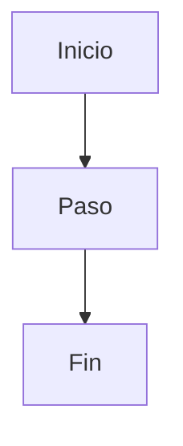

| Control del documento | |
|---|---|
| **Código** | SOP-XXX-NN |
| **Versión** | 1.0 |
| **Estado** | Plantilla comunitaria · adaptar antes de aprobar |
| **Dueño del proceso** | _(cargo)_ |
| **Aprobado por** | _(cargo que aprueba en tu organización)_ |
| **Fecha de aprobación** | AAAA-MM-DD |
| **Próxima revisión** | 12 meses después de la aprobación, o tras un incidente relevante |
| **Clasificación** | TLP:CLEAR (plantilla) · TLP:AMBER una vez adaptada con datos internos |

# SOP-XXX-NN · <Nombre del procedimiento>

## 1. Objetivo
Qué resultado garantiza este procedimiento.

## 2. Alcance
Qué cubre y qué no cubre.

## 3. Roles y responsabilidades (RACI)
| Actividad | Rol 1 | Rol 2 | Rol 3 |
|---|---|---|---|

## 4. Definiciones

## 5. Entradas y salidas
| Entradas | Salidas |
|---|---|

## 6. Procedimiento

### Paso 1 · ...
### Paso 2 · ...

## 7. Tiempos objetivo

## 8. Registros
Qué evidencia queda, dónde y por cuánto tiempo.

## 9. Indicadores

## 10. Excepciones

## 11. Traspasos
| Entrega a | Qué | Recibe de | Qué |
|---|---|---|---|

## 12. Referencias

## 13. Historial de cambios
| Versión | Fecha | Cambio | Autor |
|---|---|---|---|
| 1.0 | AAAA-MM-DD | Versión inicial | |
